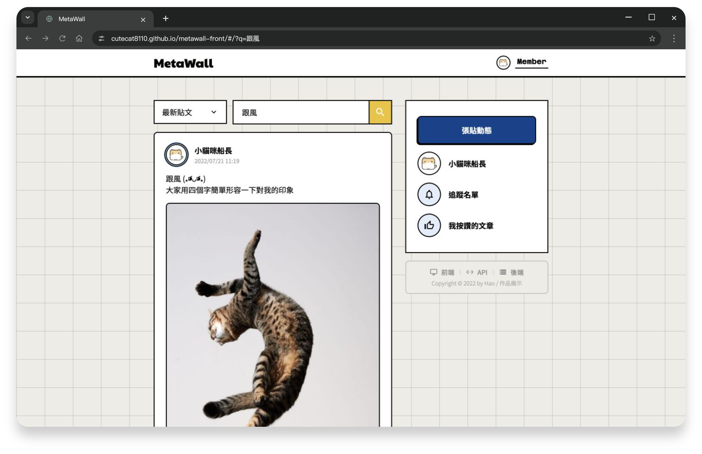

# MetaWall - 社群內容牆（前端）


> 分享生活的社群平台，支援會員註冊、圖文貼文、留言、按讚與追蹤。



## 📋 專案概述

此專案以 Vue Options API、Node.js 與 MongoDB 練習前後端開發，涵蓋介面切版、API 設計與資料串接。著重會員身分、貼文互動、圖片上傳，以及操作過程中的驗證與回饋。

**[Demo](https://cutecat8110.github.io/metawall-front/)** · [後端](https://github.com/cutecat8110/metawall-back) · [API 文件](https://metawall-backend-c89d.onrender.com/api-docs/)

## 🔨 核心技術

<table>
  <tbody>
    <tr>
      <td>
        <a href="https://vuejs.org/" >
          Vue 3
        </a>
      </td>
      <td>JavaScript 框架</td>
    </tr>
    <tr>
      <td>
        <a href="https://vuex.vuejs.org/" >
          Vuex
        </a>
      </td>
      <td>Vue.js 的狀態管理庫</td>
    </tr>
    <tr>
      <td>
        <a href="https://github.com/imcvampire/vue-axios" >
          Vue Axios
        </a>
      </td>
      <td>HTTP 請求工具</td>
    </tr>
  </tbody>
</table>

## 🛠️ 擴展套件

<table>
  <tbody>
    <tr>
      <td>
        <a href="https://sweetalert2.github.io/">
          SweetAlert 2
        </a>
      </td>
      <td>可定製訊息彈框</td>
    </tr>
    <tr>
      <td>
        <a href="https://github.com/ankurk91/vue-loading-overlay">
          Vue Loading Overlay
        </a>
      </td>
      <td>loading 效果組件</td>
    </tr>
    <tr>
      <td>
        <a href="https://vee-validate.logaretm.com/v4/">
          VeeValidate
        </a>
      </td>
      <td>表單驗證庫</td>
    </tr>
        <tr>
      <td>
        <a href="https://momentjs.com/">
          moment
        </a>
      </td>
      <td>日期和時間處理庫</td>
    </tr>
  </tbody>
</table>

## 🌸 啟動指南

使用 `.node-version` 指定的 Node 22.23.3：

```sh
npm ci
npm run serve
```

預覽路徑為 `/metawall-front/`；預設連接目前的公開 API。

## 使用說明

鑰匙可帶入「小貓咪船長」。共用帳號的帳密固定，請勿填入個人資訊；需要個人資料空間時請另行註冊。

免費後端可能冷啟動；請求等待上限 90 秒，寫入不會自動重送。圖片上傳依賴 Imgur。
